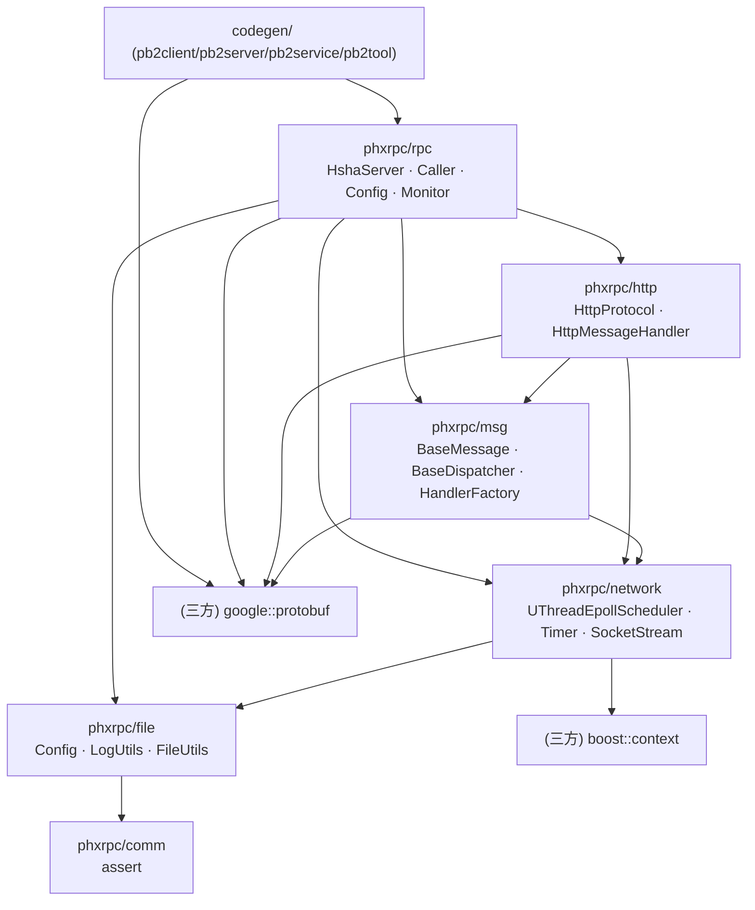

# phxrpc 源码解剖与轻舟 RPC 借鉴矩阵

> 分析对象：`Tencent/phxrpc`（工作在 `D:/phxrpc/_ref_phxrpc`，只读）。
> 本文所有结论均来自实际源码阅读，行号对应参考仓库快照。凡属推断，均显式标注「推断」。
> 作者：顾图南（架构） · 版本：v1.0

---

## 0. 一句话结论

phxrpc 是一个**用「半同步半异步 + ucontext 协程」把 C++ RPC 的样板代码压到极致**的框架：它用 protobuf 当 IDL、用 codegen 生成全部胶水、用「每连接一个协程」把 epoll 的事件驱动写成了阻塞式顺序代码。
它的工程价值在**模型**，不在**功能完备度**——它没有服务发现、没有负载均衡策略、没有重试、没有优雅退出、只能跑 Linux + GCC + 固定版本 protobuf。
轻舟 RPC 的定位因此非常清晰：**继承它的线程/协程模型思想，补齐它缺的工程能力，并把 protobuf 依赖换成自研 IDL + 自研 wire 层**。

---

## 1. 代码规模与技术栈事实

| 项目 | 事实 | 来源 |
| --- | --- | --- |
| 语言标准 | `-std=c++11` | `phxrpc.mk` `CFLAGS` |
| 编译器 | `CC = gcc`（连 C++ 也用 gcc 驱动） | `phxrpc.mk` |
| 构建系统 | 递归 Makefile，无 CMake | `Makefile`、`phxrpc/Makefile` |
| 唯一必需三方库 | protobuf（静态链接 `libprotobuf.a`） | `phxrpc.mk` `LDFLAGS` |
| 可选三方库 | boost（`boost_context` 做协程上下文） | `plugin_boost/Makefile` |
| 平台 | Linux（`epoll`）；macOS 靠 `plugin_darwin` 提供 epoll 兼容层 | `phxrpc/Makefile` `ifeq ($(OS),Darwin)` |
| 体积 | 静态库约 450 KB | `README.md` |
| 域名解析 | **无**。全链路只用 `inet_addr`，只接受 IPv4 字面量 | `network/socket_stream_block.cpp:115,210` |
| 分层 | `comm` / `file` / `network` / `msg` / `http` / `rpc` + 独立的 `codegen` | 目录结构 |

---

## 2. 整体架构

### 2.1 分层依赖（实际依赖方向）



**关键观察**：`msg` 层（`BaseMessage`/`BaseMessageHandler`）只是一个**很薄的消息抽象**，它的 `ToPb`/`FromPb` 虚函数把 protobuf 类型直接钉在了抽象基类上（`msg/base_msg.h`）。这意味着 phxrpc 的「协议可插拔」是**假的**：换掉 protobuf 必须改 `msg` 层。这是轻舟 RPC 必须解决的问题——我们让 `serde::Message` 完全不认识协议，让 `protocol::Frame` 完全不认识业务类型。

### 2.2 运行时线程/协程布局

```
                          ┌───────────────────── 服务端进程 ─────────────────────┐
                          │                                                     │
  ┌──────────────┐        │   ┌──────────────────────────────────────────┐      │
  │ Client 进程   │  TCP   │   │ HshaServerAcceptor（main 线程，忙轮询）    │      │
  │              │ ─────► │   │  accept() → QoS.CanAccept() → 轮询选 Unit │      │
  │ SearchClient │        │   └──────────────────┬───────────────────────┘      │
  │  └ Stub      │        │                 accepted_fd（跨线程入队）            │
  │  └ Caller    │        │                      ▼                              │
  │  └ HttpMsgH. │        │   ┌──────────────────────────────────────────┐      │
  └──────────────┘        │   │ HshaServerUnit[i]（IO 线程，共 IOThreadCount 个）│
        ▲                 │   │  UThreadEpollScheduler（epoll + 定时器 + 协程池）│
        │                 │   │                                          │      │
        │                 │   │  IOFunc(fd) ── 一个连接一个协程            │      │
        │                 │   │    RecvRequest → 解 HTTP 包               │      │
        │                 │   │    PushRequest(in_queue_) ──┐            │      │
        │                 │   │    UThreadWait(...)  挂起 ◄─┼── 定时器    │      │
        │                 │   │                             │   超时唤醒  │      │
        │                 │   │  ActiveSocketFunc()         │            │      │
        │                 │   │    PluckResponse(out_queue_)┘            │      │
        │                 │   │    → 唤醒对应协程 → resp->Send()          │      │
        │                 │   └──────────────┬───────────────────────────┘      │
        │                 │                  │ DataFlow：两个 ThdQueue          │
        │                 │                  ▼                                  │
        │                 │   ┌──────────────────────────────────────────┐      │
        │                 │   │ WorkerPool（固定 MaxThreads 个线程）      │      │
        │                 │   │  Worker::ThreadMode()  ── 阻塞 pop 队列   │      │
        │                 │   │  Worker::UThreadMode() ── 每线程 N 协程   │      │
        │                 │   │  WorkerLogic → dispatch_() → 业务实现     │      │
        │                 │   │  PushResponse(out_queue_) + NotifyEpoll  │      │
        │                 │   └──────────────────────────────────────────┘      │
        │                 │                                                     │
        │  ◄──────────────┼── HttpResponse（同一个 socket 写回）                 │
        │                 │   HshaServerStat（1s 采样线程）· HshaServerQos（1s 调节）│
                          └─────────────────────────────────────────────────────┘
```

三个要点：

1. **每个 `HshaServerUnit` 自带一套完整的 IO + Worker + DataFlow**。`HshaServer` 构造函数按 `MaxThreads / IOThreadCount` 把 worker 线程平均切给各 Unit（`rpc/hsha_server.cpp:842-862`）。所以「IO 线程」与「worker 线程」是**按 Unit 分组的资源环**，而不是全局共享池。
2. **IO 线程内是协程，不是回调链**。`HshaServerIO::IOFunc`（`rpc/hsha_server.cpp:586-703`）是一个 `while(true)` 顺序代码：收包 → 入队 → `UThreadWait` 挂起 → 醒来 → 发包。阻塞式写法，底层是非阻塞 epoll。
3. **跨线程通信只有两队列**：`in_queue_`（请求）与 `out_queue_`（响应），定义在 `DataFlow`（`rpc/hsha_server.h:71-72`），队列元素带 `enqueue_time_ms`，出队时直接算出排队耗时用于 QoS。

---

## 3. 八个关键机制逐个拆解

### 3.1 protobuf 作 IDL + codegen 生成 Client/Stub/Service

**做法**：`ProtoUtils::Parse` 直接用 protobuf 的编译器前端 `google::protobuf::compiler::Importer` 解析 `.proto`（`codegen/proto_utils.h:5-6`），把 AST 填进自己的 `SyntaxTree`（`codegen/syntax_tree.h`：`SyntaxFunc` 只保留 `req type / resp type / CmdID / OptString / Usage`）。然后 4 个渲染器各生成一类产物：

| 渲染器 | 产物 |
| --- | --- |
| `ClientCodeRender` | `xxx_stub.h/.cpp`（同步 RPC 调用封装）、`xxx_client.h/.cpp`（含 config 与 monitor 全局态）、`xxx_client.conf` |
| `ServiceCodeRender` | `xxx_service.h/.cpp`（服务端基类 + 虚函数）、`xxx_service_impl.h/.cpp`（用户填空）、`xxx_dispatcher.h/.cpp` |
| `ServerCodeRender` | `xxx_server.conf`、`xxx_main.cpp`、`Makefile` |
| `ToolCodeRender` | 命令行测试工具（`optstring`/`usage` 驱动） |

**生成的 Stub 形态**（`codegen/client_code_render.cpp:63-108`）：

```cpp
class SearchStub {
  public:
    SearchStub(phxrpc::BaseTcpStream &socket, phxrpc::ClientMonitor &client_monitor,
               phxrpc::BaseMessageHandlerFactory &msg_handler_factory);
    virtual ~SearchStub();
    void set_keep_alive(const bool keep_alive);
    int Search(const search::SearchRequest &req, search::SearchResult *resp);
  private:
    phxrpc::BaseTcpStream &socket_;
    phxrpc::ClientMonitor &client_monitor_;
    bool keep_alive_{false};
    phxrpc::BaseMessageHandlerFactory &msg_handler_factory_;
};
```

**关键缺陷**：Stub **持有 socket 引用**而不是连接池。所以生成的 Client 每次调用都 `BlockTcpStream socket; Open(...);`（`codegen/client_template.cpp` 的 `PHXRPC_CLIENT_FUNC_TEMPLATE`）——**默认短连接**。长连接要靠 `set_keep_alive(true)` + 用户自己管 socket 生命周期。这是轻舟 RPC 必须改掉的设计：连接应由 `ConnectionPool` 持有并被多个调用复用。

**服务端分发**：`BaseDispatcher`（`msg/base_dispatcher.h:1-50`）是个 `map<string /*uri*/, member-fn-ptr>`，按 URI 字符串查表。**字符串哈希查表在热路径上**，且 URI 是从 HTTP 请求行里解析出来的字符串。轻舟 RPC 换成 4 字节 `method_id` 直接寻址。

### 3.2 半同步半异步（独立 IO 线程 + 固定 Worker 池 + 内存队列）

**做法**：IO 线程只做「收字节 / 发字节 / 解协议 / 入队 / 等待」，业务全在 worker。判断「是否过载」的钩子分散在三处：

| 位置 | 判断 | 失败行为 |
| --- | --- | --- |
| `HshaServerAcceptor::LoopAccept` | `Qos.CanAccept()`：`hold_fds < MaxConnections` | `close(accepted_fd)` 后 `continue` |
| `HshaServerIO::IOFunc` | `DataFlow::CanPushRequest(MaxQueueLength)` | `delete req` 后 **`break`（关连接）** |
| `HshaServerIO::IOFunc` | `Qos.CanEnqueue()`：随机数 vs `enqueue_reject_rate_` | 同上，`break` |

注意后两个直接 `break` 跳出 `while(true)` → 关连接。对客户端而言是「连接被重置」，**拿不到任何协议层错误码**。这是 phxrpc 过载保护的粗暴之处。

**并发细节**：`Worker::WorkerLogic`（`rpc/hsha_server.cpp:469-497`）先 `req->GenResponse()`，再判断 `queue_wait_time_ms < MAX_QUEUE_WAIT_TIME_COST (500ms)`，超时则**丢弃业务、仍然回一个 fake 响应**，最后无论走哪条路都 `PushResponse` —— 注释写明原因是 `args`（即 socket 指针）由 worker 负责回收，不回包就内存泄漏。这是「队列元素同时承载数据与所有权」导致的耦合。

### 3.3 UThread 协程调度器

**做法**：三层。

1. `UThreadContext`（`network/uthread_context_base.h` + `uthread_context_system.cpp`）—— 对 `ucontext`（`getcontext/makecontext/swapcontext`）或 `boost::context` 的薄封装，构造时 `mmap` 一块栈，可选 guard page（`need_stack_protect`）。
2. `UThreadRuntime`（`network/uthread_runtime.h`）—— 协程表 `ContextSlot{context,next_done_item,status}` + 空闲链表 + `Yield()/Resume(index)/IsAllDone()`。
3. `UThreadEpollScheduler`（`network/uthread_epoll.h:95-166`）—— epoll 事件循环 + 最小堆定时器 + 就绪任务队列 + `todo_list_`。外部 API 是一组自由函数：`UThreadRead/UThreadSend/UThreadPoll/UThreadWait/UThreadLazyDestory`，内部 `Read` 不就绪就 `Yield()` 并把协程挂到 fd 的等待队列上。

**暴露给用户的宏**（`network/uthread_epoll.h:138-143`）：

```cpp
#define uthread_begin  phxrpc::UThreadEpollScheduler _uthread_scheduler(64*1024, 300);
#define uthread_s        _uthread_scheduler
#define uthread_t        phxrpc::__uthread(_uthread_scheduler)-
#define uthread_end      _uthread_scheduler.Run();
```

`uthread_t [=]{...};` 借助 `__uthread::operator-` 重载把 lambda 塞进任务队列，拼出 `scheduler - lambda;` 的语法糖。（`README.md` 用它实现了 Google 的 Backup Requests 模式。）

**定时器**：`Timer`（`network/timer.h`）是一个极简二项堆，元素直接是 `UThreadSocket_t*`，超时就把 socket 标脏，等 IO 协程被唤醒时自己发现「已超时」并退出（`IsUThreadDestory`）。**这是 phxrpc 里比较脆的一处**：socket 对象在 IO 协程与 worker 之间以裸指针流动，超时/正常返回两条路径都要正确 `free` / `UThreadLazyDestory`，`IOFunc` 里 700 行的分支几乎都在处理这个所有权问题。

**为什么我们不做协程**：见 §6 决策 D-04。

### 3.4 队列背压与 HshaServerQos 自适应过载拒绝

**做法**：两个 1 秒周期的后台线程。

- `HshaServerStat::CalFunc`（`rpc/hsha_server.cpp:238-348`）：把上一秒的 `atomic` 计数快照成 `xxx_qps_`，算 `rpc_avg_time_cost`、`inqueue_wait_time_costs` 均值（**仅在样本数 ≥ 1000 时才刷新**，`RPC_TIME_COST_CAL_RATE`），然后 `MonitorReport()` 上报。
- `HshaServerQos::CalFunc`（`rpc/hsha_server.cpp:371-402`）：读上一步算出的「入队平均等待 + 出队平均等待」的均值，若 `> FastRejectThresholdMS`（默认 20ms）则 `enqueue_reject_rate_ += rate`，否则 `-= rate`，夹在 `[0, 99]`。
- `CanEnqueue()` 就是 `rand()%100 >= enqueue_reject_rate_`。

**这是「按比例随机丢弃 + 排队时延闭环反馈」的经典自适应限流**，不需要配置 QPS 阈值，是很值得学的点。但它有三个问题我们会在轻舟 RPC 里修正：

1. `static default_random_engine e_rand((int)time(nullptr));` 在函数内 static —— 多线程共享一个非线程安全引擎，且每秒才调一次，`rand()` 开销不是瓶颈但**数据竞争**。
2. 拒绝的粒度是「整个连接」：`IOFunc` 里 `break` 直接关掉 socket，正在处理的同连接后续请求一并丢失。
3. `CalFunc` 与业务线程共享 `HshaServerStat` 的一堆 `atomic` 字段（如 `rpc_time_costs_`），`+=` 与 `=0` 交错会让统计漂移；`worker_idles_` 被 `++/--` 却只有 `atomic_int` 而非真正一致的快照。

轻舟 RPC 保留「时延闭环 + 按比例拒绝」的内核，但**拒绝以协议帧形式返回 `OVERLOAD` 状态码**，不关连接，并让计数全部走 `Metrics` 的无锁快照。

### 3.5 ClientMonitor / ServerMonitor 监控埋点

**做法**：`MonitorFactory`（`rpc/monitor_factory.h`）单例，可由用户替换成自己的工厂，默认返回空实现的 `ClientMonitor`/`ServerMonitor`。埋点点位非常细：

- `ServerMonitor`：`Accept / AcceptFail / RequestCount / ResponseCount / SendBytes / RecvBytes / RequestCost / ReadError / SendError / OutOfQueue / QueueDelay / FastRejectAfterAccept / FastRejectAfterRead / WrokerInQueueTimeout / WaitInInQueue / WaitInOutQueue / SvrCall`（`rpc/server_monitor.h`，注意 `Wroker` 是原仓库拼写错误）。
- `ClientMonitor`：`ClientConnect / SendBytes / SendCount / SendError / RecvBytes / RecvCount / RecvError / RequestCost / GetEndpointFail / ClientCall`。
- 调用点：`Caller::MonitorReport`（`rpc/caller.cpp:54-72`），一次 RPC 结尾统一上报 send/recv error + 字节数 + 耗时。

**评价**：点位设计是专业级的，但**默认实现全是空函数**，且上报是「由用户实现虚函数」而非「框架内建指标」——所以框架本身没有 `/metrics` 输出、没有 P99、没有 QPS 汇总。轻舟 RPC 把 `Metrics` 做成框架内建（Counter + 分桶 Histogram + P50/P99/P999 + 文本格式 dump），`Monitor` 只作为可选的导出适配层。

### 3.6 配置化（ClientConfig / ServerConfig）

**做法**：`file/config.cpp` 是个手写 INI 解析器（`[Section]` + `Key = Value`），`ServerConfig::Read` → `DoRead(Config&)` 虚函数，`HshaServerConfig::DoRead` 覆盖并读 `MaxConnections / MaxQueueLength / FastRejectThresholdMS / IOThreadCount / WorkerUThreadCount / WorkerUThreadStackSize`（`rpc/server_config.h`）。`ClientConfig` 读 `[Server0..N] IP/Port` 到 `std::vector<Endpoint_t>`，只提供 `GetRandom()` 与 `GetByIndex()`。

**问题**：
- 配置是**全局可变态**。生成的 Client 用 `static ClientConfig global_xxx_config_;`（`codegen/client_template.cpp`），`Init()` 只写一次，多线程下靠「约定」保证线程安全，代码里靠 `static mutex` 双重检查勉强维持。
- `Endpoint_t` 里是 `char ip[32]`（`rpc/client_config.h:34-37`），配不出域名。
- 配置项与结构体字段硬编码一一对应，加配置要改 4 处（h、cpp、DoRead、README）。

轻舟 RPC 的取舍：**配置就是 POD 结构体 + 一个 `Config` 读取器**，不做「配置类层级的虚函数模板方法」，`ClientOptions`/`ServerOptions` 直接聚合全部参数，可代码填也可文件填，天然不可变（构造后 `const`）。

### 3.7 长连接 / 短连接与 keep_alive

**做法**：`BaseRequest::keep_alive()` 由消息层决定（HTTP 的 `Connection:` 头）。`IOFunc` 循环末尾：

```cpp
if (!msg_handler->keep_alive() || (0 != ret)) break;
```

超时/读写失败/对端关闭都会退出循环并 `hold_fds_--`。**没有连接空闲回收、没有心跳、没有半关闭处理**。

客户端侧：默认每次调用新建连接（短连接）；要长连接得自己持有 `socket` 并对每个方法调用复用同一个 `Stub`。`PHXRPC_BATCH_CLIENT_FUNC_TEMPLATE` 展示了用协程并发打多个 server 的写法。

**我们的做法**：服务端 `idle_timeout_ms` + 定时器扫空闲连接；客户端 `ConnectionPool`（每 endpoint N 条）+ 借用/归还 + 失效连接自动剔除并重建。

### 3.8 Http / Protocol 双栈消息处理（BaseMessageHandler）

**做法**：`BaseMessageHandler`（`msg/base_msg_handler.h`）定义 5 个纯虚函数：`RecvRequest / RecvResponse / GenRequest / GenResponse / keep_alive`。`BaseMessageHandlerFactory::Create()` 每读一个请求就造一个新 handler（`rpc/hsha_server.cpp:597`）——注意是**每请求 new 一次**，因为 handler 里存了 `version_`/`keep_alive_` 状态。

`HttpProtocol`（`http/http_protocol.h`）实现 HTTP/1.1 的收发：`RecvReqStartLine / RecvHeaders / RecvBody`，`MAX_RECV_LEN = 8192`（**行长上限 8KB，且无整体 body 上限**），`RecvBody` 依赖 `Content-Length`，**不支持 `Transfer-Encoding: chunked`**（推断自 `http_protocol.cpp` 无 chunked 分支）。

`Call` 链路（`rpc/caller.cpp:74-137`）：

```
GenRequest() → FromPb(req) → set_uri() → set_keep_alive()
  → req->Send(socket)               // 上半程：写
  → RecvResponse(socket, resp)      // 下半程：阻塞读（无 epoll，纯阻塞 socket）
  → ToPb(resp) → resp->result()
```

**为什么要用 HTTP 当传输**：可以复用 curl、tcpdump 肉眼可读、跨语言调试方便。**代价**：文本解析开销、8KB 行长限制、无法表达超时/trace/压缩等二进制元数据。轻舟 RPC 用 20 字节定长二进制帧，正是针对这一点。

---

## 4. 一次 RPC 的完整数据流（跨进程）

```
Client                                    Server
------                                    ------
SearchClient::Search(req,resp)
  config_.GetRandom() → Endpoint
  BlockTcpUtils::Open()  ──── SYN ────►   accept() → AddAcceptedFd
                                          IOFunc(fd): CreateSocket → 协程 A
  Caller::Call()
    HttpRequest::FromPb(req)              A: RecvRequest → HTTP 解析
    req->Send(socket)  ──── HTTP ────►    A: CanPushRequest / CanEnqueue
                                            PushRequest(in_queue_)
                                            UThreadWait(5000ms)  ← 挂起
                                          Worker W: PluckRequest
                                            dispatch_(req,resp,args)
                                              → BaseDispatcher: uri→成员函数
                                              → SearchServiceImpl::Search
                                            PushResponse(out_queue_)
                                            scheduler->NotifyEpoll()
                                          A 被唤醒: ActiveSocketFunc 拿到 resp
                                            resp->Send(stream) ──── HTTP ────►
    RecvResponse(socket,resp)
    resp_->ToPb(resp)
    MonitorReport(...)
  return resp->result()  ◄────────────────────────────────────────────────────
```

**注意第 3 步的 `UThreadWait` 超时唤醒是「IO 协程自己定时器」级别的超时，不是「业务执行超时」**——`IOFunc` 里 `UThreadGetArgs(*socket)==nullptr` 就判定 worker 超时并 `break` 关连接，即使 worker 之后仍在跑（结果被丢弃）。

---

## 5. phxrpc 的局限（基于实际阅读，不止 6 条）

| # | 局限 | 证据 | 影响 |
| --- | --- | --- | --- |
| L-01 | **强依赖 protobuf 与 protoc 版本**：用 `google::protobuf::compiler::Importer` 做解析器，protobuf 3.x 升级会破坏 `codegen` 编译 | `codegen/proto_utils.h:5-6` | 换环境即可能编不过 |
| L-02 | **协议抽象是假的**：`BaseMessage::ToPb/FromPb` 把 protobuf 钉进 msg 基类 | `msg/base_msg.h` | 无法换序列化格式 |
| L-03 | **只支持 Linux/epoll**，macOS 靠外部 `plugin_darwin` 模拟 epoll | `phxrpc/Makefile` `ifeq ($(OS),Darwin)` | Windows 完全不可用 |
| L-04 | **无 CMake**：递归 Makefile，`CC = gcc`，产物是 `ar cru` 静态库，`phxrpc.mk` 里硬编码 `-m64 -fPIC` | `phxrpc.mk` | 无法作为 `find_package` 子模块被消费，Windows/IDE 无解 |
| L-05 | **无服务注册发现**：endpoint 只能写死在 conf 的 `[Server0..N]` | `rpc/client_config.cpp` + `codegen/client_template.cpp` | 扩容必须改配置重启 |
| L-06 | **无负载均衡策略**：只有 `GetRandom()` | `rpc/client_config.h:48` | 无法做一致性哈希/加权 |
| L-07 | **无重试、无熔断、无超时预算**：`Call` 失败即 `return ret` | `rpc/caller.cpp:118-137` | 抖动直接透传给业务 |
| L-08 | **无优雅退出**：`HshaServer` 只有 `RunForever()`，没有 `Stop()/Shutdown()`；`LoopAccept` 是 `while(true)` | `rpc/hsha_server.h:348`、`rpc/hsha_server.cpp:803-831` | 只能 kill -9，长连接被硬切 |
| L-09 | **过载即关连接**：队列满/快速拒绝都 `break` 关 socket，无协议级错误码 | `rpc/hsha_server.cpp:626-647` | 客户端只能看到「连接重置」 |
| L-10 | **数据竞争**：`Worker::shut_down_` 是普通 `bool`，跨线程读写；`HshaServerQos::CanEnqueue` 的 `static default_random_engine` 被多线程共享 | `rpc/hsha_server.h:231`、`rpc/hsha_server.cpp:367` | 未定义行为，TSan 必报 |
| L-11 | **裸指针所有权混乱**：socket 以 `void* args` 在 IO 协程与 worker 之间流动，超时/正常两条路径各自 `free` | `rpc/hsha_server.cpp:705-734` | 极难维护，改动易泄漏/复释放 |
| L-12 | **HTTP 传输开销与限制**：文本解析、`MAX_RECV_LEN=8192`、无 chunked、元数据只能塞 header | `http/http_protocol.h:38`、`http_protocol.cpp` | 无法承载 trace/超时/压缩的二进制语义 |
| L-13 | **无域名解析/DNS**：全链路 `inet_addr` | `network/socket_stream_block.cpp` | 只能配 IP |
| L-14 | **无跨语言能力**：唯一对外协议是 HTTP + protobuf body，但没有正式的 IDL 契约文档与生成的 .proto 导出 | 全仓库 | 别的语言接入要自己猜 |
| L-15 | **无内建指标输出**：`Monitor` 默认实现全空，无 `/metrics`、无 P99 | `rpc/monitor_factory.cpp` | 可观测性靠用户自己写 |
| L-16 | **codegen 产物绑死全局静态态**：`static ClientConfig global_xxx_config_` | `codegen/client_template.cpp` | 单进程多实例/多租户做不到 |
| L-17 | **无单元测试基础设施**：`test_*.cpp` 是手工 demo 程序，`codegen/test_proto_utils.cpp` 是唯一带断言味道的测试 | 目录 | 改动靠人肉回归 |

---

## 6. 借鉴与改进矩阵

> 列含义：**收益**缩写 M=可维护性、P=性能、O=可观测性、E=工程化。

| # | 机制 | phxrpc 做法 | 轻舟 RPC 做法 | 收益 |
| --- | --- | --- | --- | --- |
| M-01 | IDL | `.proto` + `protoc` 前端 AST | 自研 `.qz` DSL，Python 手写 lexer/parser（零依赖） | M E |
| M-02 | 序列化 | 链接 `libprotobuf.a`，`google::protobuf::Message` | 自研 varint TLV 编解码，**wire format 与 protobuf 兼容**但不链接它 | M P E |
| M-03 | 协议帧 | HTTP/1.1 文本 + protobuf body | 20B 定长二进制头（magic/version/flags/status/seq/method_id/body_len）+ metadata TLV + payload | P O E |
| M-04 | 方法路由 | `map<string uri, member-fn-ptr>` 字符串查表 | `method_id = FNV1a64(full_name) & 0xFFFFFFFF`，`unordered_map<uint32,Handler>` / 直接下标 | P |
| M-05 | 并发模型 | 独立 IO 线程（ucontext 协程）+ 固定 worker 线程池 + 双队列 | 主从 Reactor（1 Acceptor + N EventLoop 线程）+ 固定 worker 池 + 有界队列；**不做协程** | M E |
| M-06 | 过载保护 | 时延闭环 + 按比例随机拒绝，拒绝即关连接 | 保留时延闭环内核；拒绝返回 `OVERLOAD` 帧，不关连接；有界队列 + `Submit` 返回 `kRejected` | M O |
| M-07 | 监控 | `ServerMonitor/ClientMonitor` 虚函数，默认空实现 | 内建 `Metrics`：Counter + 分桶 Histogram（P50/P99/P999）+ 文本 dump；`Monitor` 仅作导出适配 | O |
| M-08 | 配置 | INI + `Config` 类层级 + 全局静态态 | `ClientOptions/ServerOptions` POD 结构体，构造后不可变；`Config` 只负责「文件→键值」 | M |
| M-09 | 连接管理 | 默认短连接，长连接靠用户持 socket | `ConnectionPool`（每 endpoint N 条）+ 借用/归还 + 空闲回收 + 失效重建 | P M |
| M-10 | 负载均衡 | 仅 `GetRandom()` | `RoundRobin / Random / ConsistentHash` 三种 + 可插拔接口 | E |
| M-11 | 服务发现 | 无 | 内置极简 `RegistryServer`（Register/Heartbeat/Fetch + TTL 过期）+ 客户端定时拉取 | E |
| M-12 | 重试 | 无 | `CallOptions{timeout_ms, max_retries, backoff}` + 预算控制 + 只对幂等方法重试 | E M |
| M-13 | 优雅退出 | 无 | 四步停机：停 accept → 拒绝新请求并回 `SERVICE_UNAVAILABLE` → 排空在飞请求 → 关闭连接与线程 | E |
| M-14 | 平台抽象 | 直接 `#include <sys/epoll.h>`，macOS 靠 plugin | `net/poller.h` 抽象 + `#ifdef _WIN32` WSAPoll / Linux epoll，公共头零平台依赖 | M E |
| M-15 | 所有权 | `void* args` 裸指针在 IO/worker 间流动 | `shared_ptr<Connection>` + `weak_ptr` 回调 + `enable_shared_from_this` | M |
| M-16 | 构建 | 递归 Makefile | CMake（MSVC 14.51 + GCC 双目标）+ 可选 ctest | E |
| M-17 | 测试 | 手工 demo | 单元测试（codec/serde/LB/队列）+ 回环 e2e（example 自测）+ 压测脚本 | E |
| M-18 | 跨语言 | 隐式 HTTP+pb | 明确 wire 规范文档 + `.qz` → 可选导出 `.proto`，任何 protobuf 解析器可读 payload | E |

---

## 7. 我们刻意不做什么（工程判断）

| 砍掉的东西 | 原因 |
| --- | --- |
| **ucontext / boost::context 协程** | Windows 无 `ucontext`，boost 违反「零三方依赖」。协程的核心收益是「用同步写法写异步 IO」；我们用「主从 Reactor + 线程池」拿到同等吞吐量级，代价是业务代码需感知「不能阻塞 worker」。见决策 D-04。**这个取舍本身写进文档就是加分项**。 |
| **HTTP 传输栈** | 与「二进制高效协议」的目标冲突，且文本解析是纯开销。我们保留可选的后续扩展点（`Codec` 可替换），但 v1 不实现。 |
| **protobuf 依赖 / protoc** | 违反零依赖约束；且 `codegen` 与 protoc 版本耦合是 phxrpc 最大维护痛点。 |
| **多进程模型** | phxrpc 自己也不支持（README 自述）。多进程要解决共享监听、reuseport、进程间指标聚合，收益远小于复杂度。 |
| **压缩（gzip/snappy）** | 帧头预留 `kFlagCompressed` 与 `metadata.compression` 字段，但 v1 不实现任何压缩算法——零依赖前提下自己写 deflate 是纯负担，等真有需要再加。 |
| **流式 RPC / 双向流** | 需要连接级多路复用 + 流控 + 半关闭语义，工作量与「核心框架 + 可跑 Demo」的范围严重不匹配。 |
| **TLS** | 需要 OpenSSL 或自写 TLS。零三方依赖下不可能。文档里诚实说明「传输层不加密，生产需前置 TLS 终结」。 |
| **跨语言 Client SDK** | 只交付 C++。但 wire 规范（doc 03）足够精确，第三方可自行实现。 |
| **动态服务注册的健康检查（TCP 探活）** | `RegistryServer` 只做心跳 TTL 过期，不做主动探活——探活需要额外连接池与调度，ROI 低。 |
| **分布式追踪（OpenTelemetry）** | 只透传 `trace_id`（metadata），不做 span 上报。接入 OTel 是消费方的事。 |
| **协程化的 client 并发（Backup Requests）** | 需要协程。v1 用「多线程 + 每线程独立 Channel」达到相同效果，代码更直白。 |

---

## 8. 我们明确继承的四个思想

1. **codegen 优先**：手写 RPC 胶水是万恶之源。IDL 是唯一真相，所有样板由生成器产出。
2. **IO 与业务严格线程隔离**：IO 线程只做 memcpy 级别的事，任何可能阻塞的逻辑（磁盘、锁、下游调用）必须在 worker。
3. **时延闭环的自适应限流**：不让人配 QPS 阈值，而是观测「排队时延」并动态调节拒绝比例。
4. **监控埋点前置设计**：埋点不是事后加的，而是每个关键路径（accept / read / enqueue / dispatch / write）都有对应计数器。

---

## 9. 下一步

- 架构与线程模型 → [`02-architecture.md`](02-architecture.md)
- 二进制线协议 → [`03-wire-protocol.md`](03-wire-protocol.md)
- `.qz` IDL 与生成物契约 → [`04-idl-spec.md`](04-idl-spec.md)
- 文件级任务拆分 → [`00-file-map.md`](00-file-map.md)
