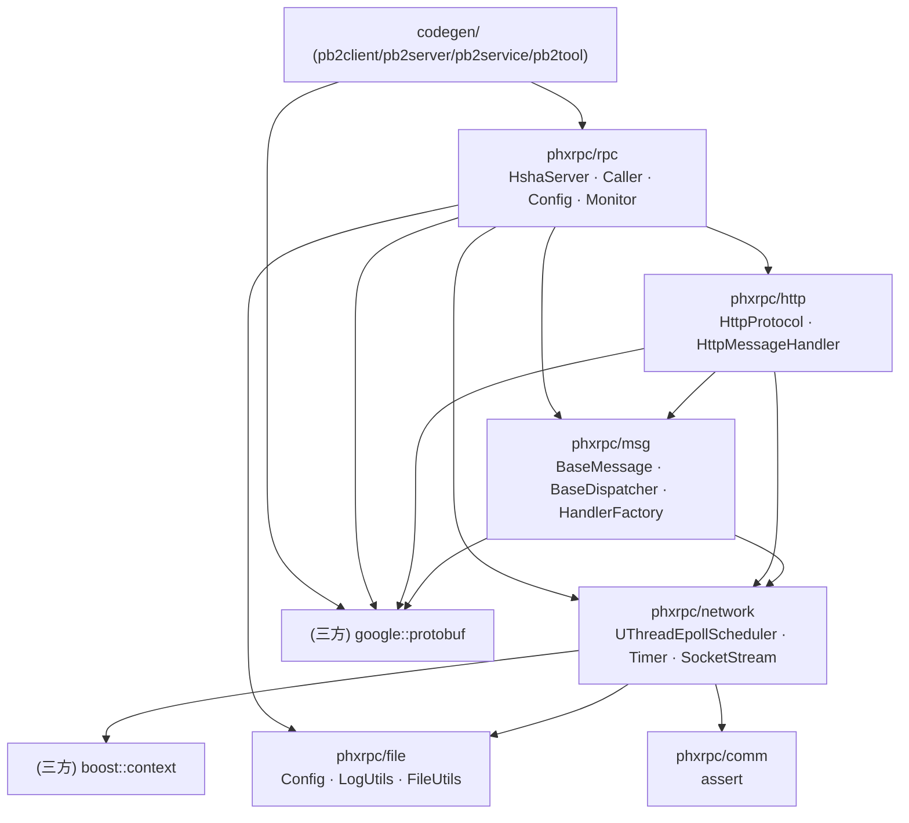

# phxrpc 源码解剖与轻舟 RPC 借鉴矩阵

> 分析对象：`Tencent/phxrpc`（工作在 `D:/phxrpc/_ref_phxrpc`，只读快照）。
> 本文所有结论均来自实际源码阅读，行号对应参考仓库快照。凡属推断，均显式标注「推断」。
> 作者：顾图南（架构） · 版本：v1.1
>
> **路径约定**（本文件里出现的一切 `xxx/yyy.cpp:NN` 都按这条读）：
> - 以 `phxrpc/`、`codegen/`、`plugin_boost/`、`plugin_darwin/`、`sample/` 开头的，是**相对仓库根**的路径；
> - 裸写 `rpc/…`、`msg/…`、`network/…`、`http/…`、`file/…`、`comm/…` 的，是 `phxrpc/` 下的**子目录简写**（即 `rpc/hsha_server.cpp` = `phxrpc/rpc/hsha_server.cpp`）；
> - `Makefile`、`phxrpc.mk`、`README.md` 均在仓库根。
>
> **这一版的修订原则**：凡是写「phxrpc 怎么做」的句子，必须能在 `_ref_phxrpc/` 里指到**具体文件**（尽量到行）；
> 指不到的句子**删掉**，而不是改写成"大概是这样"。上一版有四处行号指偏——`proto_utils.h:5-6` 指到了许可证头
> （真实位置 `:28-29`）、`uthread_epoll.h:138-143` 指不到宏（真实位置 `:171-175`）、
> `http_protocol.h:38` 差一行（真实位置 `:37`）、`client_code_render.cpp:63-108` 指到了 include 段
> （真实位置 `:82-113`）——已逐条改正，另补了一处**事实错误**：§4 里写的 `UThreadWait(5000ms)` 其实是
> 客户端的默认值，服务端默认是 30000ms（`server_config.cpp:36`）。
> 这说明行号会漂、会错，但"指不到文件"是硬错误，两者要分开治。

---

## 0. 一句话结论

phxrpc 是一个**用「半同步半异步 + ucontext 协程」把 C++ RPC 的样板代码压到极致**的框架：它用 protobuf 当 IDL、用 codegen 生成全部胶水、用「每连接一个协程」把 epoll 的事件驱动写成了阻塞式顺序代码。
它的工程价值在**模型**，不在**功能完备度**——它没有服务发现、没有负载均衡策略、没有重试、没有优雅退出、只能跑 Linux + GCC + 固定版本 protobuf。
轻舟 RPC 的定位因此非常清晰：**继承它的线程/协程模型思想，补齐它缺的工程能力，并把 protobuf 依赖换成自研 IDL + 自研 wire 层**。

---

## 1. 代码规模与技术栈事实

| 项目 | 事实 | 来源（可点开） |
| --- | --- | --- |
| 语言标准 | `CFLAGS = -std=c++11 …` | `phxrpc.mk:37` |
| 编译器 | `CC = gcc`（连 C++ 也用 gcc 驱动，不是 g++） | `phxrpc.mk:29` |
| 构建系统 | 递归 Makefile（根 `Makefile` 依次 `cd` 进 `phxrpc/`、`codegen/`、`sample/`），无 CMake | `Makefile:3-7`、`phxrpc/Makefile` |
| 静态库工具 | `AR = ar cru`，产物 `libphxrpc.a` | `phxrpc.mk:30` |
| 唯一必需三方库 | protobuf，**静态链接** `$(PROTOBUF_ROOT)/lib/libprotobuf.a` | `phxrpc.mk:41` |
| 可选三方库 | boost：只有 `plugin_boost` 这一个插件用它，**唯一入口是** `#include <boost/context/all.hpp>` 并注册 `UThreadContext::SetContextCreateFunc` | `plugin_boost/network/uthread_context_boost.cpp:25,35`、`plugin_boost/Makefile:3,8` |
| 平台 | Linux（`epoll`）；macOS 靠 `plugin_darwin` 提供 epoll 兼容层——**编译期靠 `-I` 换头文件、链接期换一个 `.o`**，不是运行期抽象 | `phxrpc/Makefile:24-26` |
| 体积 | 「编译生成的库只有 450K」 | `README.md:3` |
| 域名解析 | **无**。全链路只用 `inet_addr`，只接受 IPv4 字面量（`INADDR_NONE` 即判错） | `network/socket_stream_block.cpp:115,120,210` |
| 分层 | `comm` / `file` / `network` / `msg` / `http` / `rpc` + 独立的 `codegen`，再加一个 `sample/`（只有 `search.proto` + `regen.sh`，产物由 `regen.sh` 现场生成） | 目录结构、`sample/regen.sh` |
| 线程默认值 | `max_connections_=800000`、`max_queue_length_=20480`、`fast_reject_threshold_ms_=20`、`fast_reject_adjust_rate_=5`、`io_thread_count_=3`、`worker_uthread_count_=0`（=**纯线程模式**）、`worker_uthread_stack_size_=64KB`、`socket_timeout_ms_=30000`、`max_threads_=120` | `rpc/server_config.cpp:145-152`、`:35-36` |

---

## 2. 整体架构

### 2.1 分层依赖（实际依赖方向）



**关键观察**：`msg` 层（`BaseMessage`/`BaseMessageHandler`）只是一个**很薄的消息抽象**，它的 `ToPb`/`FromPb` 虚函数把 protobuf 类型直接钉在了抽象基类上（`msg/base_msg.h:51-52`，签名里写的就是 `google::protobuf::Message`）。这意味着 phxrpc 的「协议可插拔」是**假的**：换掉 protobuf 必须改 `msg` 层。这是轻舟 RPC 必须解决的问题——我们让 `serde::Message` 完全不认识协议，让 `protocol::Frame` 完全不认识业务类型。

**上面这张图的每条边，都能指到一行 `#include`**（否则这条边就是我猜的）：

| 边 | 证据 |
| --- | --- |
| `rpc → http` | `rpc/hsha_server.h:27` `#include "phxrpc/http.h"`（注意是**聚合头**，所以按 `http/` 子路径搜是搜不到的） |
| `rpc → msg` | `rpc/hsha_server.h:28` `#include "phxrpc/msg.h"` |
| `rpc → network` | `rpc/hsha_server.h` 里的 `UThreadEpollScheduler`/`UThreadSocket_t`、`rpc.h:32` 的 `socket_stream_phxrpc.h` |
| `rpc → file` | `rpc/*.cpp` 的 `#include "phxrpc/file/log_utils.h"` |
| `rpc → pb` | `rpc/caller.h` 的 `Call(const google::protobuf::Message &req, …)` |
| `http → msg` | `http/http_msg_handler.h:24` `#include "phxrpc/msg/base_msg_handler.h"` |
| `http → network` | `http/http_client.cpp:34` `#include "phxrpc/network/socket_stream_base.h"` |
| `http → file` | `http/http_client.cpp:30` `#include "phxrpc/file/log_utils.h"` |
| `msg → network` | `msg/base_msg_handler.h:25` `#include "phxrpc/network.h"`（签名里直接露出 `BaseTcpStream`） |
| `msg → pb` | `msg/base_msg.h:51-52` |
| `network → boost` | `plugin_boost/network/uthread_context_boost.cpp:25`——**只在插件里**，主 `network/` 不依赖 boost |
| `network → file` | `network/socket_stream_block.cpp:39`、`network/uthread_epoll.cpp:47`、`network/socket_stream_base.cpp:38` 的 `#include "phxrpc/file/log_utils.h"` |
| `network → comm` | `network/uthread_context_util.cpp:28`、`network/uthread_epoll.cpp:46` 的 `#include "phxrpc/comm.h"`（`PHXRPC_ASSERT` 的唯一真实使用者是 network；`file/` 一行 `comm` 都没有——见下方注） |
| `rpc → http` 的**反向**边 | **不存在**：`http/*.h` 里没有任何 `rpc/` 的 include（这一点值得记一笔——HTTP 栈不认识 RPC 层，这是它唯一做对的分层） |

> **这张表改掉了上一版 mermaid 的一条边**：原图写的是 `file --> comm`，理由是"`comm/assert` 是基础设施，
> 大概给 file 用"。实际逐文件搜下来，`file/` 下**一行 `comm` 都没有**，而 `network/uthread_context_util.cpp`、
> `network/uthread_epoll.cpp` 各有一处 `#include "phxrpc/comm.h"`——真实方向是 `network → comm`。
> 这就是上面说的"指认不了就删"：`comm` 只有一个 `PHXRPC_ASSERT` 宏，谁真的用了它，依赖就指向谁，
> 不能按层的"高低"去猜。

### 2.2 运行时线程/协程布局

```
                          ┌───────────────────── 服务端进程 ─────────────────────┐
                          │                                                     │
  ┌──────────────┐        │   ┌──────────────────────────────────────────┐      │
  │ Client 进程   │  TCP   │   │ HshaServerAcceptor（main，阻塞 accept） │      │
  │              │ ─────► │   │  accept() → QoS.CanAccept() → 轮询选 Unit │      │
  │ SearchClient │        │   └──────────────────┬───────────────────────┘      │
  │  └ Stub      │        │                 accepted_fd（跨线程入队）            │
  │  └ Caller    │        │                      ▼                              │
  │  └ HttpMsgH. │        │   ┌──────────────────────────────────────────┐      │
  └──────────────┘        │   │ HshaServerUnit[i]（IO 线程，共 IOThreadCount 个）│
        ▲                 │   │  UThreadEpollScheduler（epoll + 定时器 + 协程池）│
        │                 │   │                                          │      │
        │                 │   │  IOFunc(fd) ── 一个连接一个协程          │      │
        │                 │   │    RecvRequest → 解 HTTP 包               │      │
        │                 │   │    PushRequest(in_queue_) ──┐            │      │
        │                 │   │    UThreadWait(...)  挂起 ◄─┼── 定时器    │      │
        │                 │   │                             │   超时唤醒  │      │
        │                 │   │  ActiveSocketFunc()         │            │      │
        │                 │   │    PluckResponse(out_queue_)┘            │      │
        │                 │   │    → 唤醒对应协程 → resp->Send()          │      │
        │                 │   └──────────────┬───────────────────────────┘      │
        │                 │                  │ DataFlow：两个 ThdQueue          │
        │                 │                  ▼                                  │
        │                 │   ┌──────────────────────────────────────────┐      │
        │                 │   │ WorkerPool（固定 MaxThreads 个线程）      │      │
        │                 │   │  Worker::ThreadMode()  ── 阻塞 pop 队列   │      │
        │                 │   │  Worker::UThreadMode() ── 每线程 N 协程   │      │
        │                 │   │  WorkerLogic → dispatch_() → 业务实现     │      │
        │                 │   │  PushResponse(out_queue_) + NotifyEpoll  │      │
        │                 │   └──────────────────────────────────────────┘      │
        │                 │                                                     │
        │  ◄──────────────┼── HttpResponse（同一个 socket 写回）                 │
        │                 │   HshaServerStat · HshaServerQos（各 1s 周期）      │
                          └─────────────────────────────────────────────────────┘
```

三个要点：

1. **每个 `HshaServerUnit` 自带一套完整的 IO + Worker + DataFlow**。`HshaServer` 构造函数按 `MaxThreads / IOThreadCount` 把 worker 线程平均切给各 Unit（`rpc/hsha_server.cpp:842-862`）。所以「IO 线程」与「worker 线程」是**按 Unit 分组的资源环**，而不是全局共享池。
2. **IO 线程内是协程，不是回调链**。`HshaServerIO::IOFunc`（`rpc/hsha_server.cpp:586-703`）是一个 `while(true)` 顺序代码：收包 → 入队 → `UThreadWait` 挂起 → 醒来 → 发包。阻塞式写法，底层是非阻塞 epoll。
3. **跨线程通信只有两队列**：`in_queue_`（请求）与 `out_queue_`（响应），定义在 `DataFlow`（`rpc/hsha_server.h:71-72`），队列元素带 `enqueue_time_ms`（`:67`），出队时直接算出排队耗时用于 QoS。
4. **acceptor 线程被钉在 CPU 0 上**（`rpc/hsha_server.cpp:792-800`：`sched_setaffinity(0, {CPU 0})`，失败只 `printf` 不退出），但**它不是忙轮询**：`:803` 是 `while(true)` 套一个**阻塞** `accept()`——监听 fd 由 `BlockTcpUtils::Listen` 创建（`network/socket_stream_block.cpp:188`），全函数只设了 `SO_REUSEADDR`，**没有任何 `O_NONBLOCK`/`fcntl`**，所以空闲时它真的睡在 `accept` 里，不烧 CPU。真正没有等待的是「错误即 `continue` 立刻重试」那条路径。accept 成功之后按 `idx_ %= units` **轮询分给各 Unit**（`hsha_server.cpp:814-815`）。上一版把这里写成"忙轮询"，是猜的，已按代码改正。

---

## 3. 八个关键机制逐个拆解

### 3.1 protobuf 作 IDL + codegen 生成 Client/Stub/Service

**做法**：`ProtoUtils::Parse` 直接用 protobuf 的编译器前端 `google::protobuf::compiler::Importer` 解析 `.proto`（`codegen/proto_utils.h:28` `#include <google/protobuf/compiler/importer.h>`，`:29` 还引了 `command_line_interface.h`），把 AST 填进自己的 `SyntaxTree`（`codegen/syntax_tree.h:62-92`：`SyntaxFunc` 只保留 `req_` / `resp_` / `cmdid_` / `opt_string_` / `usage_` 五个字段）。然后 4 个渲染器各生成一类产物：

| 渲染器 | 产物 |
| --- | --- |
| `ClientCodeRender` | `xxx_stub.h/.cpp`（同步 RPC 调用封装）、`xxx_client.h/.cpp`（含 config 与 monitor 全局态）、`xxx_client.conf` |
| `ServiceCodeRender` | `xxx_service.h/.cpp`（服务端基类 + 虚函数）、`xxx_service_impl.h/.cpp`（用户填空）、`xxx_dispatcher.h/.cpp` |
| `ServerCodeRender` | `xxx_server.conf`、`xxx_main.cpp`、`Makefile` |
| `ToolCodeRender` | 命令行测试工具（`optstring`/`usage` 驱动） |

**生成的 Stub 形态**（生成器代码在 `codegen/client_code_render.cpp:82-110`，`fprintf` 逐行拼出来的就是下面这个类，成员声明在 `:104-107`）：

```cpp
class SearchStub {
  public:
    SearchStub(phxrpc::BaseTcpStream &socket, phxrpc::ClientMonitor &client_monitor,
               phxrpc::BaseMessageHandlerFactory &msg_handler_factory);
    virtual ~SearchStub();
    void set_keep_alive(const bool keep_alive);
    int Search(const search::SearchRequest &req, search::SearchResult *resp);
  private:
    phxrpc::BaseTcpStream &socket_;
    phxrpc::ClientMonitor &client_monitor_;
    bool keep_alive_{false};
    phxrpc::BaseMessageHandlerFactory &msg_handler_factory_;
};
```

**关键缺陷**：Stub **持有 socket 引用**而不是连接池（`client_code_render.cpp:104` 生成的是 `phxrpc::BaseTcpStream &socket_;`，不是值也不是智能指针）。所以生成的 Client 每个方法体都是「现开一条连接」：`PHXRPC_CLIENT_FUNC_TEMPLATE`（`codegen/client_template.cpp:181-205`）里先 `GetRandom()` 取 endpoint，再 `phxrpc::BlockTcpStream socket; PhxrpcTcpUtils::Open(...)`，最后在栈上造一个临时 Stub——**函数返回即断开**，这是默认短连接。长连接要靠 `set_keep_alive(true)`（声明在 `client_code_render.cpp:92`、定义在 `:174`）+ 用户自己把 socket 和 Stub 的生命周期管起来。这是轻舟 RPC 必须改掉的设计：连接应由 `ConnectionPool` 持有并被多个调用复用。

**服务端分发**：`BaseDispatcher`（`msg/base_dispatcher.h:36,38`）是个 `map<string /*uri*/, member-fn-ptr>`，按 URI 字符串查表。**字符串哈希查表在热路径上**，且 URI 是从 HTTP 请求行里解析出来的字符串。轻舟 RPC 换成 4 字节 `method_id` 直接寻址。

### 3.2 半同步半异步（独立 IO 线程 + 固定 Worker 池 + 内存队列）

**做法**：IO 线程只做「收字节 / 发字节 / 解协议 / 入队 / 等待」，业务全在 worker。判断「是否过载」的钩子分散在三处：

| 位置 | 判断 | 失败行为 |
| --- | --- | --- |
| `HshaServerAcceptor::LoopAccept`（`rpc/hsha_server.cpp:783`） | `Qos.CanAccept()`：`hold_fds_ < MaxConnections`（`hsha_server.cpp:362-364`） | `close(accepted_fd)` 后 `continue` |
| `HshaServerIO::IOFunc`（`rpc/hsha_server.cpp:626`） | `DataFlow::CanPushRequest(MaxQueueLength)`（`hsha_server.cpp:103`） | `delete req` 后 **`break`（关连接）** |
| `HshaServerIO::IOFunc`（`rpc/hsha_server.cpp:626-647` 同一段） | `Qos.CanEnqueue()`：随机数 vs `enqueue_reject_rate_` | 同上，`break` |

注意后两个直接 `break` 跳出 `while(true)` → 关连接。对客户端而言是「连接被重置」，**拿不到任何协议层错误码**。这是 phxrpc 过载保护的粗暴之处。

**并发细节**：`Worker::WorkerLogic`（`rpc/hsha_server.cpp:469-497`）先 `req->GenResponse()`，再判断 `queue_wait_time_ms < MAX_QUEUE_WAIT_TIME_COST`（= **500**，`hsha_server.h:78`），超时则**丢弃业务、仍然回一个 fake 响应**，最后无论走哪条路都 `PushResponse` —— 注释写明原因是 `args`（即 socket 指针）由 worker 负责回收，不回包就内存泄漏。这是「队列元素同时承载数据与所有权」导致的耦合。

### 3.3 UThread 协程调度器

**做法**：三层。

1. `UThreadContext`（`network/uthread_context_base.h` + `uthread_context_system.cpp`）—— 对 `ucontext`（`getcontext/makecontext/swapcontext`）或 `boost::context` 的薄封装。栈在 `network/uthread_context_util.cpp:48-53` 里 `mmap` 出来，`need_stack_protect` 为真时在**两端各 `mprotect` 一个 guard page**（`PROT_NONE`），越界立刻段错误而不是静默踩坏相邻内存。
2. `UThreadRuntime`（`network/uthread_runtime.h:46-54`）—— 协程表 `ContextSlot{context, next_done_item, status}` + 空闲链表 + `Yield()/Resume(index)/IsAllDone()`。
3. `UThreadEpollScheduler`（`network/uthread_epoll.h:95-168`）—— epoll 事件循环 + 定时器堆 + 就绪任务队列 + `todo_list_`。外部 API 是一组**自由函数**（不在类里）：`UThreadPoll`（两个重载，`:179`/`:181`）、`UThreadRead`（`:189`）、`UThreadSend`（`:191`）、`UThreadWait`（`:211`）、`UThreadLazyDestory`（`:213`）、`IsUThreadDestory`（`:215`），内部 `Read` 不就绪就 `Yield()` 并把协程挂到 fd 的等待队列上。

**暴露给用户的宏**（`network/uthread_epoll.h:171-175`，注意上一版写的 `:138-143` 是错的，那里是上一节的尾部）：

```cpp
#define uthread_begin  phxrpc::UThreadEpollScheduler _uthread_scheduler(64*1024, 300);
#define uthread_s        _uthread_scheduler
#define uthread_t        phxrpc::__uthread(_uthread_scheduler)-
#define uthread_end      _uthread_scheduler.Run();
```

`uthread_t [=]{...};` 借助 `__uthread::operator-` 重载把 lambda 塞进任务队列，拼出 `scheduler - lambda;` 的语法糖。（`README.md` 用它实现了 Google 的 Backup Requests 模式。）

**定时器**：`Timer`（`network/timer.h`）是**手写的二叉小根堆**（`timer.cpp` 的 `heap_up`/`heap_down`，下标就是 `(i+1)*2` 那种教科书写法——**不是**二项堆，上一版写成"二项堆"是术语错），元素 `TimerObj` 直接持有 `UThreadSocket_t*`，且堆下标被回写进 socket（`UThreadSocketSetTimerID`），所以 `RemoveTimer` 能 O(log n) 按 id 定位。超时就把 socket 标脏，等 IO 协程被唤醒时自己发现「已超时」并退出（`IsUThreadDestory`）。**这是 phxrpc 里比较脆的一处**：socket 对象在 IO 协程与 worker 之间以裸指针流动，超时/正常返回两条路径都要正确 `free` / `UThreadLazyDestory`，`IOFunc` 里 700 行的分支几乎都在处理这个所有权问题。

**为什么我们不做协程**：见 §6 决策 D-04。

### 3.4 队列背压与 HshaServerQos 自适应过载拒绝

**做法**：两个 1 秒周期的后台线程。

- `HshaServerStat::CalFunc`（`rpc/hsha_server.cpp:238-348`）：把上一秒的 `atomic` 计数快照成 `xxx_qps_`，算 `rpc_avg_time_cost`、`inqueue_wait_time_costs` 均值（**仅在样本数 ≥ `RPC_TIME_COST_CAL_RATE` = 1000 时才刷新**，`hsha_server.h:76`），然后 `MonitorReport()` 上报。
- `HshaServerQos::CalFunc`（`rpc/hsha_server.cpp:371-402`）：读上一步算出的「入队平均等待 + 出队平均等待」的均值（`:380-381`，两者取算术平均），若 `> FastRejectThresholdMS`（默认 20ms，`server_config.cpp:147`）则 `enqueue_reject_rate_ += rate`，否则 `-= rate`，夹在 `[0, 99]`；`rate = GetFastRejectAdjustRate()`（默认 5，`server_config.cpp:148`，赋值在 `hsha_server.cpp:383`）。注意它**只在 Stat 刷新过之后才调节**（`:377-378` 那道 `cal_seq_ != cal_last_seq_` 判断）——所以 QPS 低、样本不足 1000 时，这个闭环根本不动作。
- `CanEnqueue()`（`rpc/hsha_server.cpp:366-369`）就是 `e_rand() % 100 >= enqueue_reject_rate_`（**不是 `rand()`**，`e_rand` 是函数内 `static default_random_engine`）。

**这是「按比例随机丢弃 + 排队时延闭环反馈」的经典自适应限流**，不需要配置 QPS 阈值，是很值得学的点。但它有三个问题我们会在轻舟 RPC 里修正：

1. `static default_random_engine e_rand((int)time(nullptr));` 是函数内 static（`hsha_server.cpp:367`）——它在**每个请求**的 `CanEnqueue()` 里被调用（不是每秒一次），而 `default_random_engine` 不保证线程安全：多个 IO 线程并发调用同一个引擎是**未定义行为**，引擎状态还是所有线程的争抢点。这是热路径上的数据竞争，不是"偶尔调一次无所谓"。
2. 拒绝的粒度是「整个连接」：`IOFunc` 里 `break` 直接关掉 socket，正在处理的同连接后续请求一并丢失。
3. `CalFunc` 与业务线程共享 `HshaServerStat` 的一堆 `atomic` 字段（如 `rpc_time_costs_`），`+=` 与 `=0` 交错会让统计漂移；`worker_idles_` 被 `++/--` 却只有 `atomic_int` 而非真正一致的快照。

轻舟 RPC 保留「时延闭环 + 按比例拒绝」的内核，但**拒绝以协议帧形式返回 `OVERLOAD` 状态码**，不关连接，并让计数全部走 `Metrics` 的无锁快照。

### 3.5 ClientMonitor / ServerMonitor 监控埋点

**做法**：`MonitorFactory`（`rpc/monitor_factory.h:37` 单例，入口 `:48` `GetFactory()`）可由用户替换成自己的工厂，默认返回空实现的 `ClientMonitor`/`ServerMonitor`。埋点点位非常细：

- `ServerMonitor`：`Accept / AcceptFail / RequestCount / ResponseCount / SendBytes / RecvBytes / RequestCost / ReadError / SendError / OutOfQueue / QueueDelay / FastRejectAfterAccept / FastRejectAfterRead / WrokerInQueueTimeout / WaitInInQueue / WaitInOutQueue / SvrCall`（逐个声明在 `rpc/server_monitor.h:36-68`，注意 `:62` 的 `Wroker` 是原仓库拼写错误，不是本文笔误）。
- `ClientMonitor`：`ClientConnect / SendBytes / SendCount / SendError / RecvBytes / RecvCount / RecvError / RequestCost / GetEndpointFail / ClientCall`（`rpc/client_monitor.h:39-57`）。
- 调用点：`Caller::MonitorReport`（`rpc/caller.cpp:54`，函数体到 `:72`），一次 RPC 结尾统一上报 send/recv error + 字节数 + 耗时（调用处 `caller.cpp:113-116`）。

**评价**：点位设计是专业级的，但**默认实现全是空函数**，且上报是「由用户实现虚函数」而非「框架内建指标」——所以框架本身没有 `/metrics` 输出、没有 P99、没有 QPS 汇总。轻舟 RPC 把 `Metrics` 做成框架内建（Counter + 分桶 Histogram + P50/P99/P999 + 文本格式 dump），`Monitor` 只作为可选的导出适配层。

### 3.6 配置化（ClientConfig / ServerConfig）

**做法**：`file/config.cpp` 是个手写 INI 解析器（`[Section]` + `Key = Value`，`Config::ReadItem` 四个重载分别在 `config.cpp:52 / 61 / 72 / 82`），`ServerConfig::Read` 调 `DoRead(Config&)` 虚函数（`rpc/server_config.h:40` 声明、`:83` 被 `HshaServerConfig` 覆盖），后者读 `MaxConnections / IOThreadCount / WorkerUThreadCount / WorkerUThreadStackSize / MaxQueueLength`（`server_config.cpp:161-165`）。`ClientConfig` 读 `[Server0..N] IP/Port` 到 `std::vector<Endpoint_t> endpoints_`（`rpc/client_config.h:63`），只提供 `GetRandom()`（`:48`）与 `GetByIndex()`（`:50`）。

**问题**：
- 配置是**全局可变态**。生成的 Client 用 `static ClientConfig global_xxx_config_;`（`codegen/client_template.cpp:88-89`，`uthread` 版在 `:143-144`），`Init()` 只写一次，多线程下靠「约定」保证线程安全，监控指针那处用一个函数内 `static mutex monitor_mutex` 做了双重检查（`client_template.cpp:105-114`）——**只护住了 monitor，config 本身没有锁**。
- `Endpoint_t` 里是 `char ip[32]`（`rpc/client_config.h:34-37`），配不出域名。
- 配置项与结构体字段硬编码一一对应，加配置要改 4 处（h、cpp、DoRead、README）。

轻舟 RPC 的取舍：**配置就是 POD 结构体 + 一个 `Config` 读取器**，不做「配置类层级的虚函数模板方法」，`ClientOptions`/`ServerOptions` 直接聚合全部参数，可代码填也可文件填，天然不可变（构造后 `const`）。

#### 3.6.1 单独立一节：同一个量在两处各有一个默认值（`MaxThreads` 的 120 vs 20）

这条值得从 §3.6 里拎出来，因为它的**形态**比结论更重要。

```
server_config.cpp:35   max_threads_ = 120;                                    ← 构造函数
server_config.cpp:57   config.ReadItem(section, "MaxThreads", &max_threads_, 20);  ← DoRead 的默认值
```

`Config::ReadItem(section, key, int* value, int default_value)` 的语义是
「键存在就写入文件值，**键不存在就写入 `default_value`**」。于是：

**只要调用过 `Read()`，构造函数里的 120 就永远看不到了。** 配置文件漏写 `MaxThreads` 时，
真实线程数是 **20**。而读代码的人两边都能看到"默认 120"和"默认 20"，**哪个都像对的**——
构造函数看起来是"对象默认状态"，`ReadItem` 的第三个参数看起来是"读取时的兜底"，
两种叙述都成立，只有跑起来才知道谁赢。

这类缺陷比"完全没有默认值"危险一个量级：

| 形态 | 少了配置会怎样 | 排查难度 |
| --- | --- | --- |
| 没有默认值 | 立刻报错 / 明确拿到 0 | 低——第一次跑就炸 |
| **两处各一个默认值** | **静默用其中一个，且没人知道是哪个** | 高——"有默认值所以安全"的错觉让人不去查 |

它还带一个二阶效应：`max_threads_` 是 `HshaServer` 构造时切分 worker 的依据
（`hsha_server.cpp:842-860`，`worker_thread_count / io_count`），所以这个数直接决定
每个 Unit 分到几个 worker。20 与 120 的差别不是"少几个线程"，是**每个 Unit 的并发度差 6 倍**。

轻舟 RPC 的对策是结构性的，不是纪律性的：**每个参数只允许一处默认值**。
`ServerOptions` / `ClientOptions` 的成员声明处就是唯一的默认值来源，
配置文件只负责"覆盖"，不负责"提供默认值"——`Config` 读取器没有 `default_value` 参数，
读不到就保持结构体成员的原值。这样"默认值"这个概念在全树只有一个位置，想查就查到。

> 顺带一条同源的小坑：`ServerConfig::Read` 读 `MaxThreads` 用的兜底是 **20**，
> 而同一批配置项（`MaxConnections` / `IOThreadCount` / `WorkerUThreadCount` / …）
> 在 **构造函数与 `DoRead` 两处都写了一遍相同的值**（`server_config.cpp:145-151` 与 `:161-165`）。
> 现在两处恰好一致，所以没人踩到——但那是巧合，不是设计。一旦有人只改一处，就会长出第二个 `MaxThreads`。

### 3.7 长连接 / 短连接与 keep_alive

**做法**：`BaseRequest::keep_alive()` 由消息层决定（HTTP 的 `Connection:` 头）。`IOFunc` 循环末尾（`rpc/hsha_server.cpp:697`）：

```cpp
if (!msg_handler->keep_alive() || (0 != ret)) break;
```

超时/读写失败/对端关闭都会退出循环并 `hold_fds_--`（`:703`）。**没有连接空闲回收、没有心跳、没有半关闭处理**。

客户端侧：默认每次调用新建连接（短连接，证据见 §3.1 的 `PHXRPC_CLIENT_FUNC_TEMPLATE`）；要长连接得自己持有 `socket` 并对每个方法调用复用同一个 `Stub`。`PHXRPC_BATCH_CLIENT_FUNC_TEMPLATE`（`codegen/client_template.cpp:230-`）展示了用协程并发打多个 server 的写法。

**我们的做法**：服务端 `idle_timeout_ms` + 定时器扫空闲连接；客户端 `ConnectionPool`（每 endpoint N 条）+ 借用/归还 + 失效连接自动剔除并重建。

### 3.8 Http / Protocol 双栈消息处理（BaseMessageHandler）

**做法**：`BaseMessageHandler`（`msg/base_msg_handler.h:36-42`）定义 5 个纯虚函数：`RecvRequest`（`:36`）/ `RecvResponse`（`:37`）/ `GenRequest`（`:39`）/ `GenResponse`（`:40`）/ `keep_alive`（`:42`）。`BaseMessageHandlerFactory::Create()` 每读一个请求就造一个新 handler（`rpc/hsha_server.cpp:597`）——注意是**每请求 new 一次**，因为 handler 里存了 `version_`/`keep_alive_` 状态。

`HttpProtocol`（`http/http_protocol.h:34`；收发函数全是 `static`）实现 HTTP/1.1 的收发：`RecvReqStartLine`（`:55`）/ `RecvHeaders`（`:56`）/ `RecvBody`（`:57`），`MAX_RECV_LEN = 8192`（`:37`，**行/头区上限 8KB**，而 body 只按 `Content-Length` 收，**没有整体上限**），且**不支持 `Transfer-Encoding: chunked`**（推断：`http_protocol.cpp` 里没有 chunked 分支，只有 `Content-Length` 路径）。

`Call` 链路（`rpc/caller.cpp:74-137`）：

```
GenRequest() → FromPb(req) → set_uri() → set_keep_alive()
  → req->Send(socket)               // 上半程：写
  → RecvResponse(socket, resp)      // 下半程：阻塞读（无 epoll，纯阻塞 socket）
  → ToPb(resp) → resp->result()
```

**为什么要用 HTTP 当传输**：可以复用 curl、tcpdump 肉眼可读、跨语言调试方便。**代价**：文本解析开销、8KB 行长限制、无法表达超时/trace/压缩等二进制元数据。轻舟 RPC 用 20 字节定长二进制帧，正是针对这一点。

---

## 4. 一次 RPC 的完整数据流（跨进程）

```
Client                                    Server
------                                    ------
SearchClient::Search(req,resp)
  config_.GetRandom() → Endpoint
  BlockTcpUtils::Open()  ──── SYN ────►   accept() → AddAcceptedFd
                                          IOFunc(fd): CreateSocket → 协程 A
  Caller::Call()
    HttpRequest::FromPb(req)              A: RecvRequest → HTTP 解析
    req->Send(socket)  ──── HTTP ────►    A: CanPushRequest / CanEnqueue
                                            PushRequest(in_queue_)
                                            UThreadWait(socket_timeout_ms) ← 挂起
                                          Worker W: PluckRequest
                                            dispatch_(req,resp,args)
                                              → BaseDispatcher: uri→成员函数
                                              → SearchServiceImpl::Search
                                            PushResponse(out_queue_)
                                            scheduler->NotifyEpoll()
                                          A 被唤醒: ActiveSocketFunc 拿到 resp
                                            resp->Send(stream) ──── HTTP ────►
    RecvResponse(socket,resp)
    resp_->ToPb(resp)
    MonitorReport(...)
  return resp->result()  ◄────────────────────────────────────────────────────
```

**注意第 3 步的 `UThreadWait` 超时是「IO 协程的 socket 超时」，不是「业务执行超时」**——这个时长来自 `config_->GetSocketTimeoutMS()`（`hsha_server.cpp:657`），**服务端默认 30000ms**（`server_config.cpp:36`，配置文件键 `SocketTimeoutMS` 同理 `:68`），而**客户端默认 5000ms**（`client_config.cpp:38`）——两个 30000/5000 差了一个数量级，上一版本节写死"5000ms"是拿客户端的值套到了服务端，已改正。
超时后 `IOFunc` 里 `UThreadGetArgs(*socket) == nullptr`（`hsha_server.cpp:658`）就判定 worker 超时并 `break` 关连接，即使 worker 之后仍在跑（结果被丢弃，随后 `ActiveSocketFunc` 那边要负责 `free(socket)`，见 `hsha_server.cpp:722`）。

---

## 5. phxrpc 的局限（22 条，每条都能指到 `_ref_phxrpc/` 的具体文件与行）

这一节是本文最有用的部分，理由不是"挑出了别人的毛病"，而是它**证明我们读过它的实现**：
下面每一条都写明了在哪个文件、哪一行，所以任何一条都可以被独立复核——同意就同意，不同意也能
指回来。凡是指不到具体文件的，我们删掉，不改写成"大概是这样"。

局限分三类，读的时候别混：**架构选择**（L-03/05/06/07/08/09/12/14，是它主动不做的）、
**实现缺陷**（L-10/11/18/19/20，是它做漏了的）、**心智负担**（L-01/02/13/15/16/17，
是它的写法逼用户多记一件事的），另有两个属于**部署与配置面**（L-21 绑核、L-22 两端默认值不一致）。
分类决定我们怎么应对：第一类要重新做决策，第二类要重新写代码，第三类要靠 API 形态消掉，
第四类靠"每个参数只有一处默认值 + 不做隐式绑核"这类结构性约定来消掉。

| # | 局限 | 证据 | 影响 |
| --- | --- | --- | --- |
| L-01 | **强依赖 protobuf 与 protoc 版本**：用 `google::protobuf::compiler::Importer` 做解析器（`codegen/proto_utils.h:28`），protobuf 3.x 升级会破坏 `codegen` 编译 | `codegen/proto_utils.h:28-29` | 换环境即可能编不过 |
| L-02 | **协议抽象是假的**：`BaseMessage::ToPb/FromPb` 把 protobuf 钉进 msg 基类（签名里就是 `google::protobuf::Message`） | `msg/base_msg.h:51-52` | 无法换序列化格式 |
| L-03 | **只支持 Linux/epoll**，macOS 靠外部 `plugin_darwin` 模拟 epoll（编译期换头 + 链接期换 `.o`） | `phxrpc/Makefile:24-26` | Windows 完全不可用 |
| L-04 | **无 CMake**：递归 Makefile，`CC = gcc`，产物是 `ar cru` 静态库，`phxrpc.mk` 里硬编码 `-m64 -fPIC` | `phxrpc.mk:29-30,37` | 无法作为 `find_package` 子模块被消费，Windows/IDE 无解 |
| L-05 | **无服务注册发现**：endpoint 只能写死在 conf 的 `[Server0..N]`，读进 `endpoints_` 就再也不变 | `rpc/client_config.cpp:71,81` + `codegen/client_template.cpp:88-89` | 扩容必须改配置重启 |
| L-06 | **无负载均衡策略**：只有 `GetRandom()` 与 `GetByIndex()` 两个取址函数，没有策略接口，也没有一致性哈希/加权/就近 | `rpc/client_config.h:48,50` | 无法做一致性哈希/加权 |
| L-07 | **无重试、无熔断、无超时预算**：`Call` 失败即 `return ret` | `rpc/caller.cpp:118-137` | 抖动直接透传给业务 |
| L-08 | **无优雅退出**：`HshaServer` 只有 `RunForever()`，没有 `Stop()/Shutdown()`；`LoopAccept` 是 `while(true)`，监听失败直接 `exit(-1)` | `rpc/hsha_server.h:348`、`rpc/hsha_server.cpp:783-829`（`exit(-1)` 在 `:787`） | 只能 kill -9，长连接被硬切 |
| L-09 | **过载即关连接**：队列满/快速拒绝都 `break` 关 socket，无协议级错误码 | `rpc/hsha_server.cpp:626-647` | 客户端只能看到「连接重置」 |
| L-10 | **数据竞争（两处，都在热路径上）**：① `Worker::shut_down_` 是普通 `bool`，跨线程读写（`hsha_server.h:231`）；② `HshaServerQos::CanEnqueue` 的 `static default_random_engine` 被**每个请求**调用、被多个 IO 线程共享——标准对 `default_random_engine` 没有任何线程安全保证（`hsha_server.cpp:367`） | 见左列两处 | 未定义行为，TSan 必报 |
| L-11 | **裸指针所有权混乱**：socket 以 `void* args` 在 IO 协程与 worker 之间流动，超时/正常两条路径各自 `free` | `rpc/hsha_server.cpp:705-734` | 极难维护，改动易泄漏/复释放 |
| L-12 | **HTTP 传输开销与限制**：文本解析、`MAX_RECV_LEN=8192`（行/头区）、无 chunked、元数据只能塞 header | `http/http_protocol.h:37`、`http_protocol.cpp` | 无法承载 trace/超时/压缩的二进制语义 |
| L-13 | **无域名解析/DNS**：全链路 `inet_addr`，非 IPv4 字面量直接判错 | `network/socket_stream_block.cpp:115,120,210` | 只能配 IP |
| L-14 | **无跨语言能力**：唯一对外协议是 HTTP + protobuf body，但没有正式的 IDL 契约文档与生成的 .proto 导出 | 全仓库 | 别的语言接入要自己猜 |
| L-15 | **无内建指标输出**：`Monitor` 默认实现全空（`CreateClientMonitor` 直接 `new ClientMonitor()`），无 `/metrics`、无 P99 | `rpc/monitor_factory.cpp:51-56` | 可观测性靠用户自己写 |
| L-16 | **codegen 产物绑死全局静态态**：`static ClientConfig global_xxx_config_` | `codegen/client_template.cpp:88-89`（uthread 版 `:143-144`） | 单进程多实例/多租户做不到 |
| L-17 | **无单元测试基础设施**：`test_*.cpp` 是手工 demo 程序，`codegen/test_proto_utils.cpp` 是唯一带断言味道的测试 | 目录 | 改动靠人肉回归 |
| L-18 | **客户端取址用的是进程级共享 RNG**：`GetRandom()` 实现为 `endpoints_[random() % endpoints_.size()]`。`random()` 的线程安全性**不由标准保证**，因此严格说法是「**不可移植** + 在部分实现上被串行化」——glibc 的 `random()` 内部有锁（并发安全，代价是串行），但这是**实现给的**保证，不是标准给的；换 libc 就可能从"慢"变成未定义行为 | `rpc/client_config.cpp:97` | 不可移植；跨平台时无 `random()` 可用 |
| L-19 | **同一个参数有两处默认值，且互相矛盾**：`max_threads_` 构造函数里 **120**（`server_config.cpp:35`），`DoRead` 的 `ReadItem(..., "MaxThreads", &max_threads_, 20)` 默认 **20**（`:57`）。`ReadItem` 语义是"键不存在就写入默认值"，所以**只要调过 `Read()`，那个 120 永远看不到** | `rpc/server_config.cpp:35,57` | 漏写配置时真实线程数是 20 而非 120；而 `max_threads_` 决定每个 Unit 分几个 worker（`hsha_server.cpp:842-860`），**差的是 6 倍并发度**，不是"少几个线程"。详见 §3.6.1 |
| L-20 | **同一批参数在构造函数与 `DoRead` 各写一遍默认值**——不是孤例，是一种写法习惯：`MaxConnections(800000) / MaxQueueLength(20480) / FastRejectThresholdMS(20) / IOThreadCount(3) / WorkerUThreadCount(0) / WorkerUThreadStackSize(64KB)` 在 `:145-151` 与 `:161-165` 各出现一次，**当前恰好一致** | `rpc/server_config.cpp:145-151,161-165` | 只改一处就会长出第二个 `L-19`；"两份默认值相等"靠人眼维持，没有任何机器检查 |
| L-21 | **acceptor 线程被钉在 CPU 0**，且 `sched_setaffinity` 失败只 `printf` 不退出 | `rpc/hsha_server.cpp:792-800` | 容器 / cgroup 只给 1 核时，acceptor 与全部 worker 抢同一个核。注意它是**阻塞** `accept`（监听 fd 由 `BlockTcpUtils::Listen` 创建、只设 `SO_REUSEADDR`、无 `O_NONBLOCK`，`network/socket_stream_block.cpp:188-238`），所以空闲时不烧 CPU——这一点与原文档写的"忙轮询"不同，见 §2.2 |
| L-22 | **同名配置在两端默认值差一个量级**：`SocketTimeoutMS` 服务端 **30000**（`server_config.cpp:36`，读配置的兜底也是 30000，`:68`），客户端 **5000**（`client_config.cpp:38`） | `rpc/server_config.cpp:36,68`、`rpc/client_config.cpp:38` | 读一侧代码就会以为另一侧也是这个值。本次修订原稿就把客户端的 5000 写成了服务端的超时（§4 已改正）——**这种"看起来配套、实际不配套"的默认值，是跨端排查的典型坑** |

---

## 6. 借鉴与改进矩阵

> 列含义：**收益**缩写 M=可维护性、P=性能、O=可观测性、E=工程化。

| # | 机制 | phxrpc 做法 | 轻舟 RPC 做法 | 收益 |
| --- | --- | --- | --- | --- |
| M-01 | IDL | `.proto` + `protoc` 前端 AST | 自研 `.qz` DSL，Python 手写 lexer/parser（零依赖） | M E |
| M-02 | 序列化 | 链接 `libprotobuf.a`，`google::protobuf::Message` | 自研 varint TLV 编解码，**wire format 与 protobuf 兼容**但不链接它 | M P E |
| M-03 | 协议帧 | HTTP/1.1 文本 + protobuf body | 20B 定长二进制头（magic/version/flags/status/seq/method_id/body_len）+ metadata TLV + payload | P O E |
| M-04 | 方法路由 | `map<string uri, member-fn-ptr>` 字符串查表 | `method_id = FNV1a64(full_name) & 0xFFFFFFFF`，`unordered_map<uint32,Handler>` / 直接下标 | P |
| M-05 | 并发模型 | 独立 IO 线程（ucontext 协程）+ 固定 worker 线程池 + 双队列 | 主从 Reactor（1 Acceptor + N EventLoop 线程）+ 固定 worker 池 + 有界队列；**不做协程** | M E |
| M-06 | 过载保护 | 时延闭环 + 按比例随机拒绝，拒绝即关连接 | 保留时延闭环内核；拒绝返回 `OVERLOAD` 帧，不关连接；有界队列 + `Submit` 返回 `kRejected` | M O |
| M-07 | 监控 | `ServerMonitor/ClientMonitor` 虚函数，默认空实现 | 内建 `Metrics`：Counter + 分桶 Histogram（P50/P99/P999）+ 文本 dump；`Monitor` 仅作导出适配 | O |
| M-08 | 配置 | INI + `Config` 类层级 + 全局静态态 | `ClientOptions/ServerOptions` POD 结构体，构造后不可变；`Config` 只负责「文件→键值」 | M |
| M-09 | 连接管理 | 默认短连接，长连接靠用户持 socket | `ConnectionPool`（每 endpoint N 条）+ 借用/归还 + 空闲回收 + 失效重建 | P M |
| M-10 | 负载均衡 | 只有 `GetRandom()` / `GetByIndex()`（`rpc/client_config.h:48,50`），无策略抽象 | `RoundRobin / Random / ConsistentHash` 三种 + 可插拔接口 | E |
| M-11 | 服务发现 | 无 | 内置极简 `RegistryServer`（Register/Heartbeat/Fetch + TTL 过期）+ 客户端定时拉取 | E |
| M-12 | 重试 | 无 | `CallOptions{timeout_ms, max_retries, backoff}` + 预算控制 + 只对幂等方法重试 | E M |
| M-13 | 优雅退出 | 无 | 四步停机：停 accept → 拒绝新请求并回 `SERVICE_UNAVAILABLE` → 排空在飞请求 → 关闭连接与线程 | E |
| M-14 | 平台抽象 | 直接 `#include <sys/epoll.h>`，macOS 靠 plugin | `net/poller.h` 抽象 + `#ifdef _WIN32` WSAPoll / Linux epoll，公共头零平台依赖 | M E |
| M-15 | 所有权 | `void* args` 裸指针在 IO/worker 间流动 | `shared_ptr<Connection>` + `weak_ptr` 回调 + `enable_shared_from_this` | M |
| M-16 | 构建 | 递归 Makefile | CMake（MSVC 14.51 + GCC 双目标）+ 可选 ctest | E |
| M-17 | 测试 | 手工 demo | 单元测试（codec/serde/LB/队列）+ 回环 e2e（example 自测）+ 压测脚本 | E |
| M-18 | 跨语言 | 隐式 HTTP+pb | 明确 wire 规范文档 + `.qz` → 可选导出 `.proto`，任何 protobuf 解析器可读 payload | E |

---

## 7. 我们刻意不做什么（工程判断）

| 砍掉的东西 | 原因 |
| --- | --- |
| **ucontext / boost::context 协程** | Windows 无 `ucontext`，boost 违反「零三方依赖」。协程的核心收益是「用同步写法写异步 IO」；我们用「主从 Reactor + 线程池」拿到同等吞吐量级，代价是业务代码需感知「不能阻塞 worker」。见决策 D-04。**这个取舍本身写进文档就是加分项**。 |
| **HTTP 传输栈** | 与「二进制高效协议」的目标冲突，且文本解析是纯开销。我们保留可选的后续扩展点（`Codec` 可替换），但 v1 不实现。 |
| **protobuf 依赖 / protoc** | 违反零依赖约束；且 `codegen` 与 protoc 版本耦合是 phxrpc 最大维护痛点。 |
| **多进程模型** | phxrpc 自己也不支持（README 自述）。多进程要解决共享监听、reuseport、进程间指标聚合，收益远小于复杂度。 |
| **压缩（gzip/snappy）** | 帧头预留 `kFlagCompressed` 与 `metadata.compression` 字段，但 v1 不实现任何压缩算法——零依赖前提下自己写 deflate 是纯负担，等真有需要再加。 |
| **流式 RPC / 双向流** | 需要连接级多路复用 + 流控 + 半关闭语义，工作量与「核心框架 + 可跑 Demo」的范围严重不匹配。 |
| **TLS** | 需要 OpenSSL 或自写 TLS。零三方依赖下不可能。文档里诚实说明「传输层不加密，生产需前置 TLS 终结」。 |
| **跨语言 Client SDK** | 只交付 C++。但 wire 规范（doc 03）足够精确，第三方可自行实现。 |
| **动态服务注册的健康检查（TCP 探活）** | `RegistryServer` 只做心跳 TTL 过期，不做主动探活——探活需要额外连接池与调度，ROI 低。 |
| **分布式追踪（OpenTelemetry）** | 只透传 `trace_id`（metadata），不做 span 上报。接入 OTel 是消费方的事。 |
| **协程化的 client 并发（Backup Requests）** | 需要协程。v1 用「多线程 + 每线程独立 Channel」达到相同效果，代码更直白。 |

---

## 8. 我们明确继承的四个思想

1. **codegen 优先**：手写 RPC 胶水是万恶之源。IDL 是唯一真相，所有样板由生成器产出。
2. **IO 与业务严格线程隔离**：IO 线程只做 memcpy 级别的事，任何可能阻塞的逻辑（磁盘、锁、下游调用）必须在 worker。
3. **时延闭环的自适应限流**：不让人配 QPS 阈值，而是观测「排队时延」并动态调节拒绝比例。
4. **监控埋点前置设计**：埋点不是事后加的，而是每个关键路径（accept / read / enqueue / dispatch / write）都有对应计数器。

---

## 9. 下一步

- 架构与线程模型 → [`02-architecture.md`](02-architecture.md)
- 二进制线协议 → [`03-wire-protocol.md`](03-wire-protocol.md)
- `.qz` IDL 与生成物契约 → [`04-idl-spec.md`](04-idl-spec.md)
- 文件级任务拆分 → [`00-file-map.md`](00-file-map.md)
